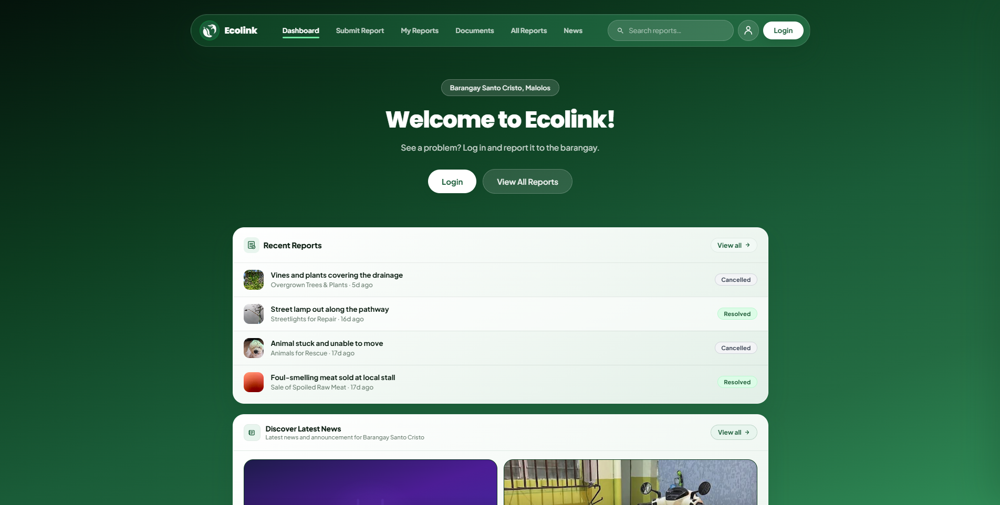
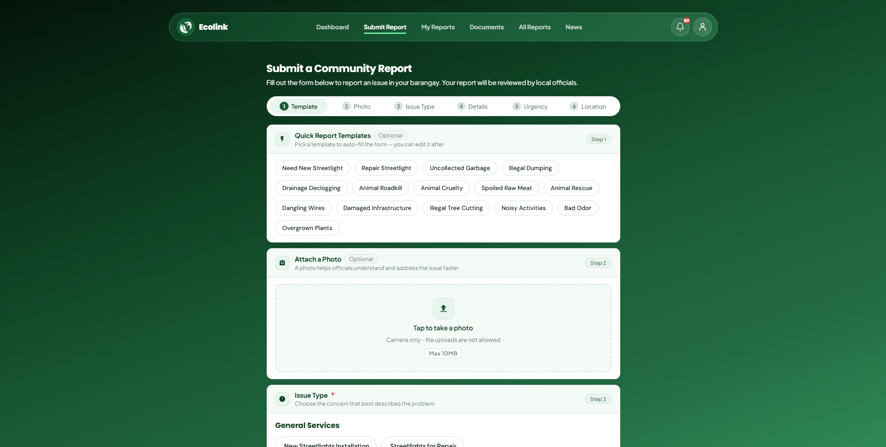
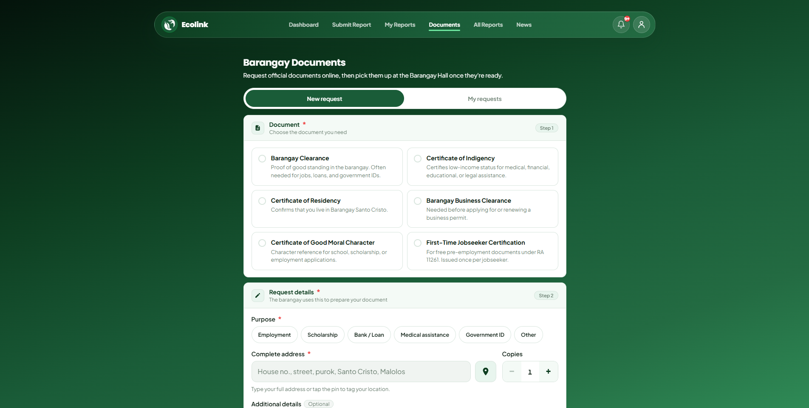
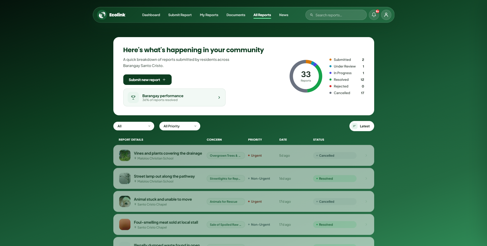

# ECOLINK – Citizen Reporting System

A web-based and mobile-responsive citizen reporting system for **Barangay Santo Cristo, Malolos, Bulacan**. Residents can report community problems (like broken streetlights, uncollected garbage, or blocked drainage), request barangay documents, and follow the status of their reports.

🌐 **Live system** → https://ecolink-unha.onrender.com/
*(It runs on a free server, so the first visit may take up to a minute to load.)*

## My Role
**Capstone Project Leader** of a four-member team. The code was written by our team's developer. My work was:

- Led a four-member team in creating the system
- Used the Scrum method to plan the work and keep the team on schedule
- Gathered requirements from Barangay Santo Cristo officials
- Wrote 93 test cases covering unit, integration, system, and performance testing
- Kept a bug log during testing
- Handled the team's research paper
- Evaluated the system with 147 residents and barangay officials and 3 IT experts, using ISO 25010 and TAM
- Helped plan the data flow diagrams (DFDs) with the team's developer
- Designed the ECOLINK logo
- Passed the final defense in October 2026

## Screenshots

**Dashboard**

**Submit a Report**

**Barangay Documents**

**All Reports**

